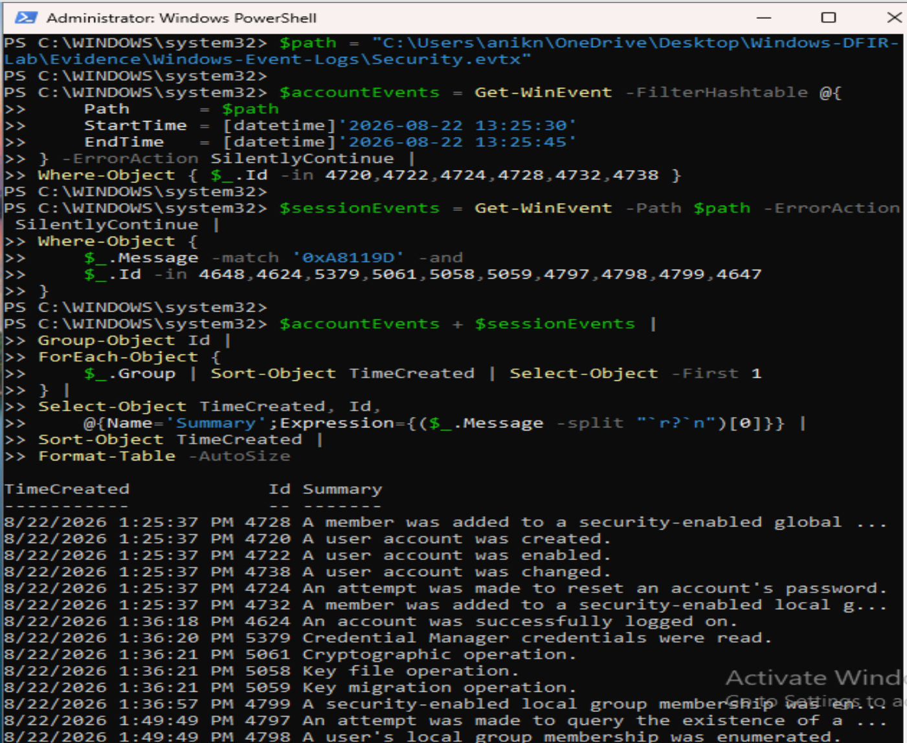
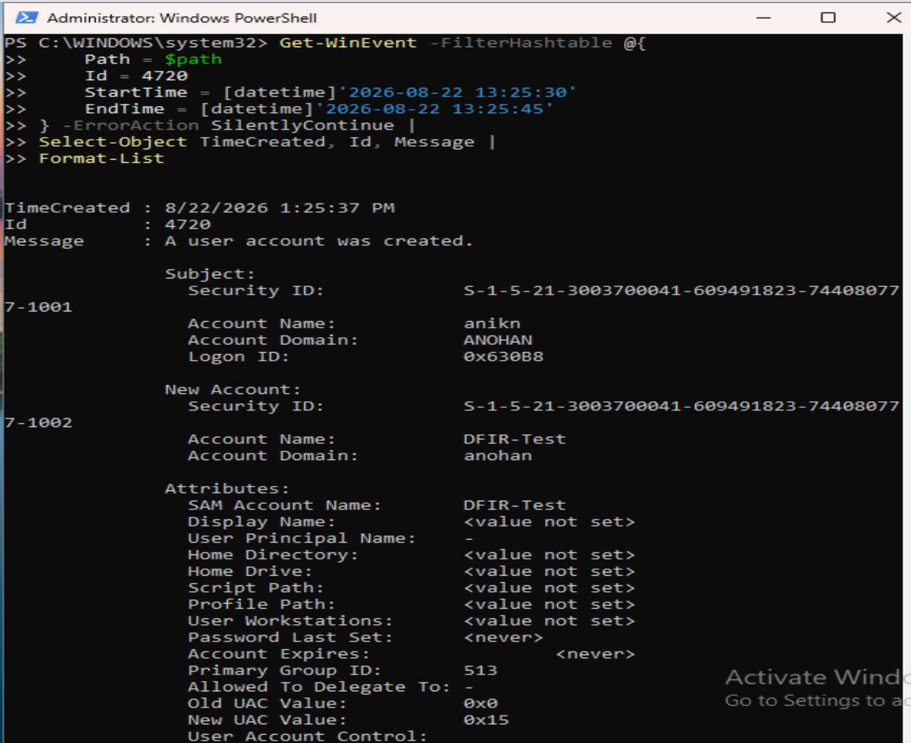
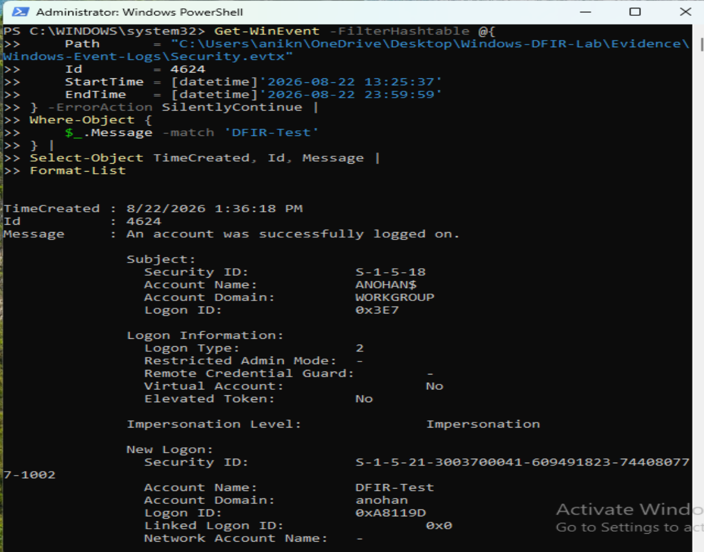
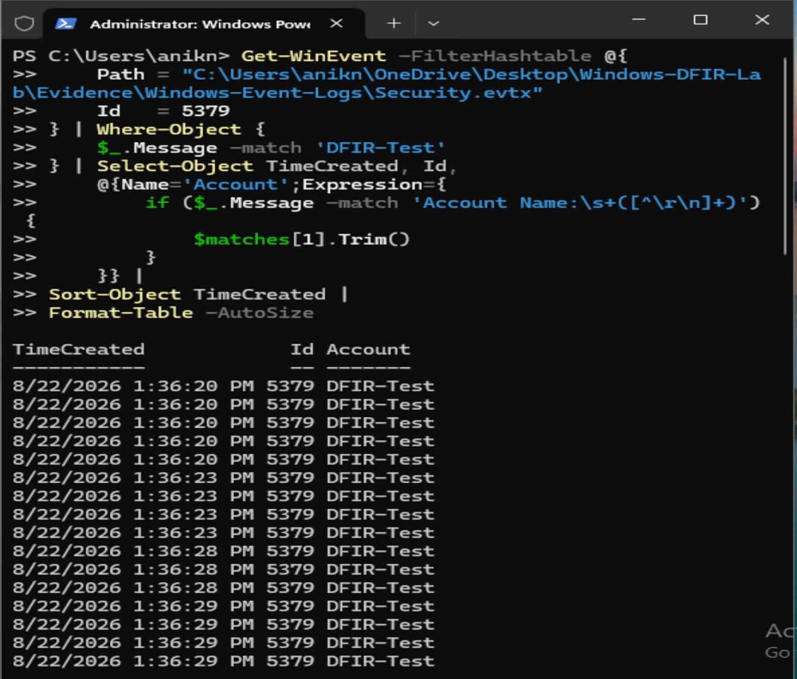
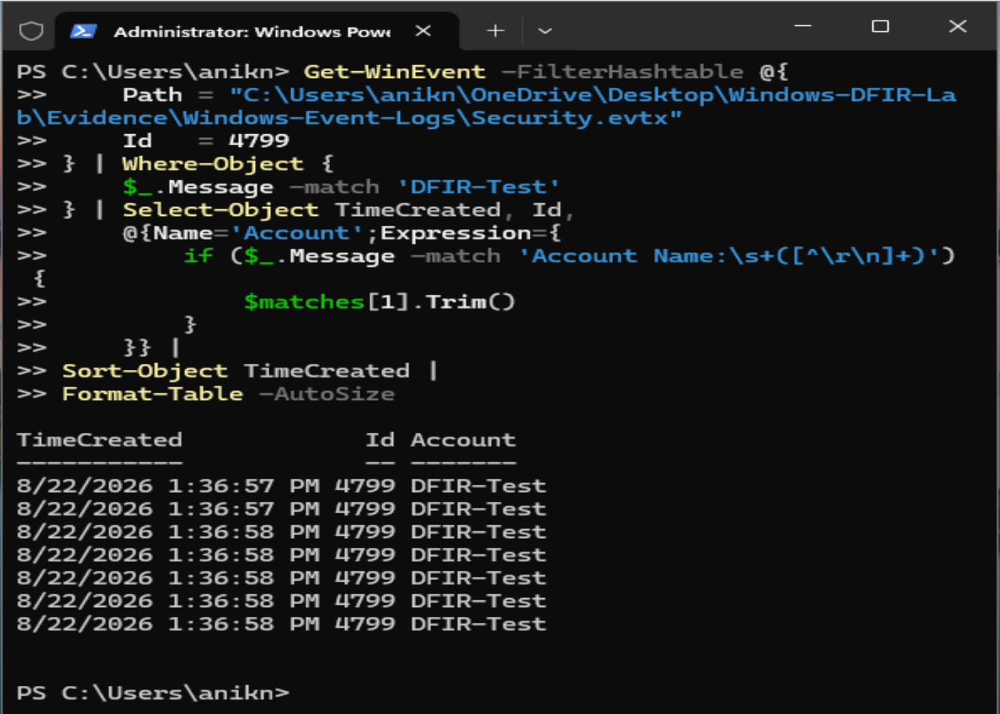
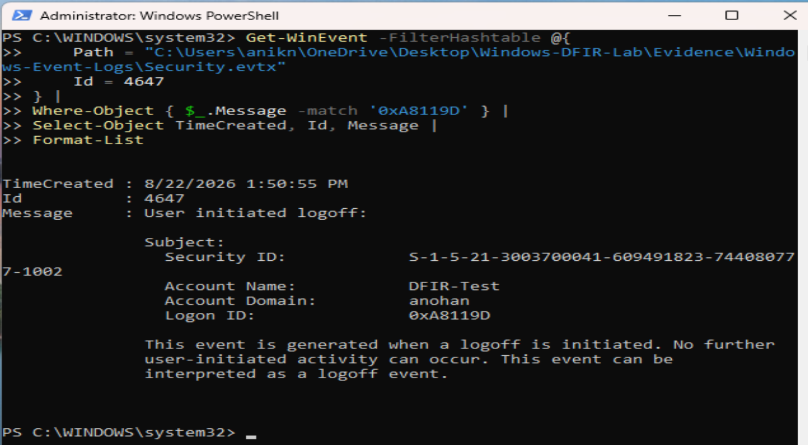
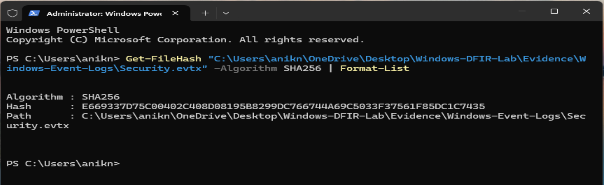
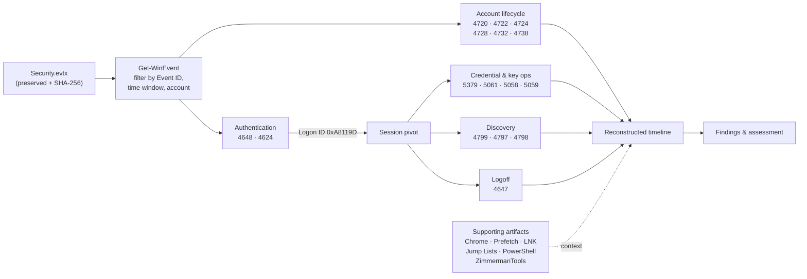

# Windows DFIR: Security Event Investigation


A hands-on **Windows Digital Forensics and Incident Response (DFIR)** investigation that reconstructs the full lifecycle of a local Windows account, `DFIR-Test`, from the **Windows Security event log**. Starting from a raw `Security.evtx` file, I used PowerShell (`Get-WinEvent`) to pull, filter and correlate events by Event ID, timestamp, account name and **Logon ID**, and rebuilt a timeline that runs from account creation through authentication, credential and key activity, account and group discovery, and finally a user-initiated logoff.

Every finding is backed by numbered screenshots of the commands and their output, and the log file's integrity is recorded with a SHA-256 hash.

> **Bottom line:** the Security log alone was enough to reconstruct a coherent 16-event sequence for `DFIR-Test`, tied together by Logon ID `0xA8119D`, covering an interactive session of about **14 minutes 37 seconds** (13:36:18 → 13:50:55 on 2026-08-22).



## Why I Did This

Reading single Windows events is easy; turning a log full of them into a defensible story is the actual job of a DFIR or SOC analyst. I wanted a project that forced the whole discipline end to end: preserve the evidence, query it precisely, pivot on identifiers like the Logon ID rather than eyeballing timestamps, record the searches that came back empty, and separate what the log *shows* from what it *proves*. Creating and using a test account in a controlled lab gave me ground truth to check my reconstruction against.

## Highlights

- **Account lifecycle reconstruction:** six account-management events (4720, 4722, 4724, 4728, 4732, 4738) at `13:25:37` establish how `DFIR-Test` was created and configured.
- **Authentication analysis:** explicit credential use (4648) and a successful interactive logon (4624) at `13:36:18`.
- **Logon ID correlation:** Logon ID `0xA8119D` from the 4624 event is used to tie every later session event, through to the 4647 logoff, back to the same session.
- **Credential and cryptographic activity:** Credential Manager read (5379), cryptographic operation (5061), key file operation (5058) and key migration (5059) within seconds of logon.
- **Discovery activity:** Administrators group enumeration (4799), local-account blank-password queries (4797) and user local-group enumeration (4798).
- **Session timing:** logon-to-logoff duration calculated at roughly 14 minutes 37 seconds.
- **Supporting artifacts:** Chrome history and downloads, Prefetch, LNK files, Jump Lists, PowerShell history and logs, and ZimmermanTools-related evidence, kept as context around the Security log.
- **Evidence integrity:** EVTX metadata and SHA-256 hashing of `Security.evtx`.
- **Evidence-first documentation:** 137 numbered screenshots, including negative results (searches that returned nothing) retained as part of the record.

## Screenshots

| Account created (4720) | Interactive logon (4624, Logon ID `0xA8119D`) |
|---|---|
|  |  |

| Credential Manager read (5379) | Administrators group enumeration (4799) |
|---|---|
|  |  |

| User-initiated logoff (4647) | Evidence integrity (SHA-256) |
|---|---|
|  |  |

All 137 screenshots are in [`evidence/screenshots/`](evidence/screenshots/), numbered in the order they are referenced in the [evidence notes](evidence/evidence-notes.md).

## Tools & Technologies

- **Windows Security event log (`Security.evtx`):** primary evidence source.
- **PowerShell (`Get-WinEvent`, `Get-FileHash`):** event filtering by ID, time window, account and Logon ID; hashing for integrity.
- **Windows Event Viewer:** event inspection and validation.
- **Chrome artifacts:** browser history and download records for supporting context.
- **Prefetch, LNK files and Jump Lists:** execution and file-access context.
- **ZimmermanTools:** Windows forensic artifact and timeline analysis support.
- **SHA-256:** evidence integrity verification.
- **GitHub:** evidence preservation and case documentation.

## Investigation Flow



## Investigation Workflow

1. **Preserve the evidence:** collect `Security.evtx`, record its metadata and SHA-256 hash.
2. **Survey the log:** event ID frequency and logon-type summaries to understand what the log contains.
3. **Account lifecycle:** query account-management events for `DFIR-Test` around `13:25:37`.
4. **Authentication:** locate the 4648 and 4624 events and extract the session's Logon ID (`0xA8119D`).
5. **Session correlation:** pivot on that Logon ID to collect credential, cryptographic, discovery and logoff events from the same session.
6. **Negative checks:** run searches for activity that might be expected (for example process creation) and keep the empty results.
7. **Supporting artifacts:** review browser, Prefetch, LNK, Jump List, PowerShell and ZimmermanTools evidence for context.
8. **Timeline reconstruction:** merge the events into one ordered timeline and calculate session duration.
9. **Assessment:** document findings, separating observation from interpretation.

## Reconstructed Timeline

All times are 2026-08-22, as recorded in [`analysis/security-event-timeline.md`](analysis/security-event-timeline.md).

| Timestamp | Event ID | Activity |
|---|---:|---|
| 13:25:37 | 4720 | DFIR-Test account created |
| 13:25:37 | 4722 | DFIR-Test account enabled |
| 13:25:37 | 4724 | Password reset attempted for DFIR-Test |
| 13:25:37 | 4728 | Security-enabled global group membership changed |
| 13:25:37 | 4732 | DFIR-Test added to Builtin Users group |
| 13:25:37 | 4738 | DFIR-Test account changed |
| 13:36:18 | 4648 | Explicit credentials used for DFIR-Test |
| 13:36:18 | 4624 | Successful interactive logon (Logon ID `0xA8119D`) |
| 13:36:20 | 5379 | Credential Manager credentials read |
| 13:36:21 | 5061 | Cryptographic operation |
| 13:36:21 | 5058 | Key file operation |
| 13:36:21 | 5059 | Key migration operation |
| 13:36:58 | 4799 | Administrators group membership enumerated |
| 13:49:49 | 4797 | Local account blank-password queries |
| 13:49:50 | 4798 | User local-group membership enumeration |
| 13:50:55 | 4647 | DFIR-Test initiated logoff |

**Session:** successful logon at `13:36:18` → user-initiated logoff at `13:50:55` ≈ **14 minutes 37 seconds**.

## Key Findings

Summarised from [`analysis/investigation-findings.md`](analysis/investigation-findings.md):

1. **Account creation and configuration:** at `13:25:37` the account was created, enabled, had a password reset attempted, had global group membership changed, was added to Builtin Users, and was changed.
2. **Authentication:** at `13:36:18` explicit credentials were used (4648) and a successful interactive logon was recorded (4624) with Logon ID `0xA8119D`.
3. **Credential and cryptographic activity:** within seconds of logon, Credential Manager credentials were read (5379), followed by cryptographic, key file and key migration operations (5061, 5058, 5059).
4. **Account and group discovery:** the session later shows Administrators group enumeration (4799), blank-password queries against local accounts (4797) and user local-group enumeration (4798).
5. **Session termination:** a user-initiated logoff (4647) at `13:50:55` ends the session.

**Assessment:** the Security log provides enough evidence to reconstruct a coherent sequence of account-management, authentication, credential-related, discovery and logoff activity for `DFIR-Test`. Individual events are interpreted in context and alongside the supporting artifacts, not treated as independent proof of malicious activity.

## Repository Structure

```text
windows-dfir-security-event-investigation/
├── README.md
├── LICENSE
├── analysis/
│   ├── investigation-findings.md     # executive summary, key findings, assessment
│   └── security-event-timeline.md    # reconstructed timeline + session summary
└── evidence/
    ├── evidence-notes.md             # what each screenshot shows and why it matters
    └── screenshots/                  # 137 numbered evidence screenshots
```

## Project Documentation

1. [Investigation Findings](analysis/investigation-findings.md): executive summary, the five key findings and the overall assessment.
2. [Security Event Timeline](analysis/security-event-timeline.md): the 16-event reconstructed timeline, session summary and key observations.
3. [Evidence Notes](evidence/evidence-notes.md): explanation of every numbered screenshot.
4. [Evidence Screenshots](evidence/screenshots/): the raw visual evidence record.

## How to Review

1. **Start with the findings:** read [investigation-findings.md](analysis/investigation-findings.md) for the case in two minutes.
2. **Follow the timeline:** walk through [security-event-timeline.md](analysis/security-event-timeline.md) event by event.
3. **Check the evidence:** use [evidence-notes.md](evidence/evidence-notes.md) to jump to the screenshot behind each claim, for example the 4624 logon showing Logon ID `0xA8119D` and the 4647 logoff matching it.
4. **Verify integrity:** compare the recorded SHA-256 hash of `Security.evtx` in the integrity screenshots.
5. **Look at the context:** browse the Chrome, Prefetch, LNK, Jump List, PowerShell and ZimmermanTools screenshots that surround the Security log analysis.

## Skills Demonstrated

- **Windows event log forensics:** account-management, logon, credential, cryptographic and discovery Event IDs and what each one records.
- **PowerShell for DFIR:** precise `Get-WinEvent` queries with hashtable filters, time windows, message matching and summarised output.
- **Session correlation:** pivoting on Logon ID to group events into one user session instead of relying on timestamps alone.
- **Timeline reconstruction:** merging events into an ordered, defensible narrative and calculating session duration.
- **Windows artifact analysis:** Chrome history and downloads, Prefetch, LNK, Jump Lists and PowerShell history as supporting evidence.
- **Evidence handling:** metadata capture, SHA-256 integrity verification and a numbered evidence trail.
- **Analytical discipline:** documenting negative results and separating observation from assessment.
- **Technical writing:** findings, timeline and evidence notes written for both technical reviewers and hiring managers.

## Roadmap

- Map observed activity to MITRE ATT&CK techniques (e.g. account creation, account and group discovery)
- Export the timeline to CSV and build it with Timeline Explorer / EvtxECmd
- Add Sigma-style detection ideas for the discovery events (4797, 4798, 4799)
- Correlate with Sysmon process and network telemetry in a follow-up case

---

## Disclaimer

This investigation was performed in a controlled lab environment on a test account created for the purpose. It does not contain evidence from a production environment, and the activity documented is not attributed to a real threat actor. Individual events should be interpreted in context rather than treated as independent proof of malicious activity.

---

## Author

**Anik Nohan**

This case study was built to practise and demonstrate real-world DFIR and SOC analyst skills in:

- Windows Security event log analysis
- Digital forensics and incident response methodology
- Timeline reconstruction and evidence correlation
- PowerShell-based investigation
- Evidence integrity and documentation

Also see my **[CyberHire AI Cybersecurity Interview Simulator](https://github.com/aniknohan/cyberhire-windows-ai-lab)** and **[Phishing Email Investigation SOC Portfolio](https://github.com/aniknohan/phishing-email-investigation-soc-portfolio)**.

### Tools Used

`Windows Security Log` • `PowerShell` • `Get-WinEvent` • `Event Viewer` • `Chrome Artifacts` • `Prefetch` • `LNK` • `Jump Lists` • `ZimmermanTools` • `SHA-256` • `GitHub`

## License

Released under the [MIT License](LICENSE).
